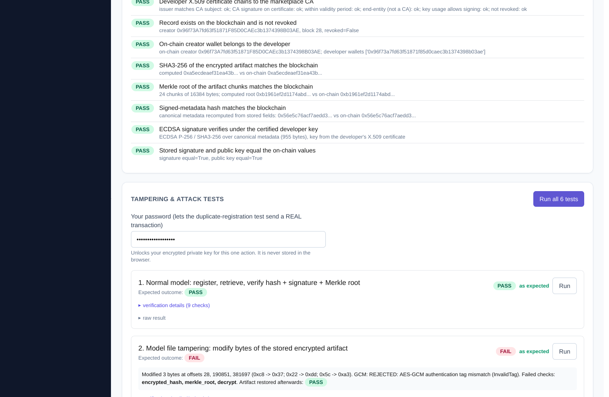

# Decentralized AI Model Marketplace with Cryptographic Verification

Team 20 · Applied Cryptography + Blockchain

One integrated application that takes an AI model through its whole life:

```
Dataset → Train → Evaluate → Deploy (inference API) → SHA3-256 → AES-256-GCM → Merkle tree
        → X.509-checked ECDSA signature → Blockchain registration → Verification → Secure distribution
```

Every stage consumes the **real output of the previous one** (the exact trained artifact is hashed, encrypted, chunked into a
Merkle tree, signed and registered on a real smart contract; buyers receive the actual decrypted artifact only after the
blockchain record, Merkle root and signature have been verified). Nothing is mocked or hard-coded.



---------------------------------------------------------------------------------------------------

## Contents
1. [Quick start](#1-quick-start) · 2. [Prerequisites](#2-prerequisites--installation) · 3. [Environment variables](#3-environment-variables) ·
4. [MongoDB](#4-mongodb-setup) · 5. [Hardhat chain](#5-hardhat-local-blockchain) · 6. [Contract](#6-smart-contract-compile--deploy) ·
7. [Backend](#7-backend) · 8. [Frontend](#8-frontend) · 9. [MetaMask](#9-metamask-local-network) ·
10. [Demo workflow](#10-complete-demonstration-workflow) · 11. [Tests](#11-tests-and-results) · 12. [Troubleshooting](#12-troubleshooting) ·
13. [Honest limitations](#13-limitations--what-was-and-was-not-tested) · 14. [Project layout](#14-project-layout)

---------------------------------------------------------------------------------------------------

## 1. Quick start

**Windows** — double-click `start.bat` (or run `.\scripts\start.ps1` in PowerShell).
**Linux / macOS / WSL / Git-Bash** — `./scripts/start.sh`

The script checks prerequisites, creates `.env` (with a freshly generated master passphrase), creates a Python venv and
installs dependencies, runs `npm install`, starts MongoDB (if installed), the Hardhat blockchain, compiles + deploys the
smart contract, and starts the backend and frontend. When it prints **ready**, open <http://localhost:3000>.
Stop everything with `stop.bat` / `./scripts/stop.sh`.

Options: `-NoFrontend` / `--no-frontend`, `-ProdFrontend` / `--prod-frontend` (optimised build instead of `next dev`).

## 2. Prerequisites & installation

| Tool | Version | Needed for |
|---|---|---|
| Python | 3.10 – 3.12 (tick **"Add to PATH"** on Windows) | backend, ML, cryptography |
| Node.js + npm | 18 LTS or newer | Hardhat chain, contract tooling, Next.js frontend |
| MongoDB Community Server | 6+ (optional) | persistence (a file-backed dev fallback exists, see §4) |
| MetaMask browser extension | any recent | optional "register with MetaMask" path (§9) |
| Firefox + geckodriver | optional | only for the real-browser test |

Manual install (what the start script does for you):

```bash
python -m venv .venv
# Windows: .\.venv\Scripts\Activate.ps1        Linux/macOS: source .venv/bin/activate
pip install -r requirements.txt
(cd blockchain && npm install)
(cd frontend  && npm install)
```

## 3. Environment variables

Copy `.env.example` to `.env` (the start script does this) — every variable is documented in that file.

| Variable | Default | Meaning |
|---|---|---|
| `MARKETPLACE_MASTER_PASSPHRASE` | *(generated)* | **Required**, ≥ 12 chars. Protects the CA private key and the content-key escrow. Read only from the environment; never stored in the DB or storage. **Back it up** – without it the CA key and escrowed model keys cannot be opened. |
| `DB_MODE` | `auto` | `auto` = MongoDB if reachable else file fallback · `mongo` = require MongoDB · `file` = force fallback |
| `MONGODB_URI` / `MONGODB_DB` | `mongodb://127.0.0.1:27017` / `model_marketplace` | MongoDB connection (local, Docker or Atlas) |
| `CHAIN_RPC_URL` | `http://127.0.0.1:8545` | blockchain JSON-RPC |
| `CHAIN_ADMIN_PRIVATE_KEY` | Hardhat Account #0 | marketplace operator wallet (authorizes developer wallets, tops them up). **Public test key – local development only.** |
| `AUTO_FUND_WALLETS`, `FUND_AMOUNT_ETH` | `true`, `5` | give new developer wallets test ETH (local chain only) |
| `MARKETPLACE_STORAGE` | `./storage` | models, datasets, CA, dev DB |
| `MAX_UPLOAD_MB`, `MERKLE_CHUNK_SIZE`, `DOWNLOAD_TTL_SECONDS`, `SESSION_TTL_HOURS` | 50, 16384, 600, 12 | tuning |
| `API_ACCESS_LOG` | *(unset)* | optional: append every `/api` call (`METHOD path status`) to this file; used by the endpoint-coverage check |
| `BACKEND_URL` (frontend) | `http://127.0.0.1:8000` | where Next.js proxies `/api/*` (see `frontend/.env.example`) |

## 4. MongoDB setup

The backend stores users, datasets, model metadata, licenses/grants, deployment info and verification logs in MongoDB.

* **Windows**: install *MongoDB Community Server* (https://www.mongodb.com/try/download/community) with "Run as a Service" — it listens on
  `127.0.0.1:27017`, nothing else to do. (Optionally install Compass to browse the data.)
* **Docker**: `docker run -d --name mongo -p 27017:27017 mongo:7`
* **Atlas (free tier)**: create a cluster, add your IP, put the connection string in `MONGODB_URI`.
* **Linux/macOS**: use your package manager (`brew install mongodb-community`, distro packages, or Docker).

Check: `http://127.0.0.1:8000/api/health` → `"database": {"mode": "mongodb", "fallback": false}`; the dashboard also shows it.

**Development fallback (documented, explicit).** If MongoDB is unreachable and `DB_MODE=auto`, the backend prints a warning and uses a
*persistent file-backed store* under `storage/devdb/*.json` (survives restarts; **not** an in-memory dict). The dashboard and
`/api/health` flag it as `file-fallback`. It is single-process only (run one backend worker) and intended for machines without
MongoDB. Set `DB_MODE=mongo` to forbid the fallback. Both stores pass the identical test-suite (§11).

## 5. Hardhat local blockchain

```bash
cd blockchain
npx hardhat node          # keep this terminal open; prints 20 funded test accounts (chain id 31337)
```

The chain lives in memory: **restarting the node wipes it** (see §12). The start script launches it for you.

## 6. Smart contract compile & deploy

`blockchain/contracts/ModelRegistry.sol` (Solidity 0.8.20) enforces: only admin-authorized wallets may register; `msg.sender` becomes
the immutable owner; one registration per model id (duplicates revert); hashes/Merkle root/signature can never be changed;
only the owner can update the license or revoke.

```bash
cd blockchain
npm run compile           # solc (npm package, 0.8.20) -> artifacts-custom/ModelRegistry.json
npm run deploy            # deploys if the chain has no contract yet, writes blockchain/deployment.json
npm run deploy:fresh      # force a new deployment
npm test                  # 17 behavioural tests against the live chain (real transactions)
```

Why `solc` from npm instead of `npx hardhat compile`? Hardhat downloads a native compiler binary at first use, which fails behind some
firewalls/proxies; the npm `solc` (solc-js) compiler is the same 0.8.20 and needs no download. Hardhat is still used for the local
chain (`hardhat node`), and `hardhat.config.js` is kept for anyone who prefers `npx hardhat compile`.

## 7. Backend

```bash
# project root, venv active, .env present, chain running + contract deployed
uvicorn backend.app.main:app --port 8000
```

Interactive API docs: <http://127.0.0.1:8000/docs> (55 endpoints). Health: `/api/health`. The backend refuses to start without
`MARKETPLACE_MASTER_PASSPHRASE`. If the chain/contract is unavailable it still starts and reports it; chain-dependent endpoints return 503.

## 8. Frontend

```bash
cd frontend
npm install
npm run dev               # http://localhost:3000        (or: npm run build && npm run start)
```

The browser only talks to the Next.js server, which proxies `/api/*` to the backend (no CORS setup needed).

## 9. MetaMask local network

MetaMask is only needed for the optional **"Register with MetaMask"** path (the default path registers with your built-in developer wallet).

1. In the app click **Connect MetaMask** (top right), then on *Blockchain Registry* click **Add / switch MetaMask to "Hardhat Local"**
   — or add it manually: *Settings → Networks → Add*: RPC URL `http://127.0.0.1:8545`, Chain ID `31337`, symbol `ETH`.
2. Use any MetaMask account. When you click *Register with MetaMask* the backend links that address to your developer account,
   authorizes it on the contract and tops it up with test ETH automatically (`AUTO_FUND_WALLETS`). Alternatively import a Hardhat
   test account key printed by `hardhat node` (public keys — never use them on a real network).
3. After you **restart the Hardhat node**, reset MetaMask's cached nonces: *Settings → Advanced → Clear activity tab data*.

## 10. Complete demonstration workflow

Use two browser profiles (or sign out/in) for a developer and a buyer.

| # | Page | Action | What to show / say |
|---|---|---|---|
| 1 | Sign in | *Create account* → role **Developer** (`alice`) | CA issues an **X.509 certificate**; an ECC P-256 key pair and an Ethereum wallet are created; private keys are stored only password-encrypted (scrypt + HKDF + AES-GCM) |
| 2 | **Train Model** | click **digits**, algorithm *Random Forest* (or *Neural Network* for a live loss curve), **Train model** | dataset validation report, live training log/progress, accuracy / precision / recall / F1, confusion matrix, artifact SHA3-256 |
| 3 | **Deploy Model** | **Deploy model**, then a *Test-set sample* → **Predict** | deployed artifact hash == trained artifact hash; real inference |
| 4 | **Cryptographic Protection** | enter password → **Run all 4 steps** (or run them one by one) | SHA3-256 → AES-256-GCM (CSPRNG key/nonce, AAD) → Merkle tree (verify any chunk with its proof) → certificate check + ECDSA signature; plaintext securely deleted |
| 5 | **Blockchain Registry** | password → **Register with my developer wallet** (or **MetaMask**) | real transaction hash, block number, gas; *"direct blockchain read"* via wagmi/viem shows the record without trusting the backend |
| 6 | Sign in as a **Buyer** → **Marketplace** | open the model → **Run verification**; optionally **Download encrypted artifact** | 8 checks recomputed and compared with the **on-chain** values; the ciphertext's SHA3-256 equals the on-chain encrypted hash and is useless without the key |
| 7 | same page | **Request access** → enter password → **Verify & decrypt securely** | authorization report: license → certificates → **retrieve the encrypted model** → blockchain record → hash/Merkle/signature → ECDH+HKDF key exchange → AES-GCM → plaintext hash == on-chain hash; then **Download** and run inference on the distributed copy |
| 8 | repeat 7 | second download | `single-use` license exhausted → denied (try also a wrong password → key not released) |
| 9 | Developer → **Security Verification** | password → **Run all 6 tests** | normal PASS · file tampering FAIL (bytes/offsets, GCM `InvalidTag`, Merkle chunks) · signature/metadata tampering FAIL · unauthorized wallet REJECTED (real failed tx) · duplicate id REJECTED · unauthorized download DENIED |
| 10 | **Dashboard** | — | live totals: trained / deployed / registered models, verification pass/fail, tamper tests |

Licenses (chosen in step 4): `single-use` (1 download), `unlimited`, `approval-required` (the developer approves each buyer on the
Marketplace page — try it with a second buyer).

To demo the **CIFAR-10** dataset from the presentation: `python datasets/prepare_cifar10.py`, then upload `datasets/cifar10_subset.csv` (see `datasets/README.md`).

## 11. Tests and results

```bash
./scripts/run_all_tests.sh --browser     # Windows: see scripts\run_tests.ps1
```

Runs on a **clean, separate test database/storage** (never your real data) and writes `tests/results/TEST_REPORT.md`:

| Suite | Tests | What it proves |
|---|---|---|
| `test_crypto_suite.py`, `test_cifar_prepare.py` | 28 | NIST SHA3 + RFC 5869 HKDF vectors, AES-GCM tamper/AAD/key checks, ECDSA, ECDH, key wrapping, X.509 chain/expiry/revocation, Merkle proofs + second-preimage regressions, CIFAR conversion |
| `blockchain/scripts/test_contract.js` | 17 | live-chain contract behaviour: authorization, ownership, duplicates, immutability, revocation |
| `test_integration.py` | 28 | HTTP API on real MongoDB + real chain: auth/roles, dataset validation, training of all 7 algorithms, evaluation endpoint, deploy/predict/undeploy/redeploy-from-ciphertext, protection order, logout invalidation, **no secrets at rest**, real on-chain registration verified independently via web3, MetaMask-style registration, verification, Merkle proofs, licenses, tamper-blocks-distribution, full tamper suite, dashboard cross-checks |
| `test_persistence.py` | 1 | after a backend restart: data/sessions persist and the deployed model reloads from the **encrypted** artifact |
| `test_browser_e2e.py` | 12 | the real UI in headless Firefox: login guards, valid + invalid **CSV upload**, train, deploy/**undeploy**/redeploy, **step-by-step protection with ordered/disabled controls**, register, the developer's **approve/deny** flow, buyer verify/request/**download (SHA3 of the file == on-chain hash)**, encrypted-artifact download, inference, security suite, dashboard, wallet stand-in |
| `endpoint_coverage.py` | 1 | **every one of the 55 API operations** was called during the run (fails otherwise); report in `tests/results/ENDPOINT_COVERAGE.md` |

Latest results: **86 / 86 passed** (+ 55/55 endpoint coverage) on MongoDB 8.3 + Hardhat; the same API/integration suites also pass on the file fallback
(`tests/results/file_fallback/`). Screenshots from the browser run: `tests/results/screenshots/`.

## 12. Troubleshooting

| Symptom | Cause / fix |
|---|---|
| `MARKETPLACE_MASTER_PASSPHRASE must be set` | `.env` missing → run the start script, or copy `.env.example` and set a ≥12-char passphrase |
| `does not match the stored CA key` | the passphrase changed after the CA was created. Restore the old passphrase, or reset: stop everything, delete `storage/` and drop the database |
| `no blockchain node reachable` / `contract not deployed` | start `npx hardhat node`, then `npm run deploy` in `blockchain/` (the start script does both) |
| Models show *registered* but verification says "no on-chain record" | the Hardhat node was restarted → the in-memory chain was wiped. Keep the node running during a demo, or reset all data (delete `storage/`, drop the DB) and re-register |
| `Port 3000/8000/8545/27017 already in use` | stop the other process or run `stop.bat` / `./scripts/stop.sh` |
| MetaMask: *nonce too high* / transaction stuck | after restarting Hardhat: MetaMask → Settings → Advanced → *Clear activity tab data* |
| MetaMask: wrong network | use **Add / switch MetaMask to "Hardhat Local"** (chain id 31337) |
| Wallet *insufficient funds* | click *Register with MetaMask* again (it re-links and tops up) or keep `AUTO_FUND_WALLETS=true` |
| Dashboard says `file-fallback` | MongoDB is not reachable (§4). Fine for demos; install MongoDB for real use |
| PowerShell blocks `start.ps1` | use `start.bat`, or `powershell -ExecutionPolicy Bypass -File scripts\start.ps1` |
| `npm install` fails | check Node ≥ 18 and your proxy settings; delete `node_modules` and retry |
| Dataset rejected | the upload report lists the exact reasons (too few rows, single-class target, continuous target, …) |
| "Wrong password – cannot unlock your key" | your password decrypts your private key; there is **no reset** by design |
| Logs | `.run/logs/*.log` (mongod, hardhat, backend, frontend) |

## 13. Limitations / what was and was not tested

Be upfront with your examiners about these:

* **Windows scripts are untested on Windows.** `start.ps1` / `stop.ps1` / `*.bat` were written for Windows and syntax-checked with a real
  PowerShell 7 parser, but only the Linux scripts were *executed* (the development sandbox is Linux). The manual commands in §4–§8 work on any OS.
* **Real MetaMask was not tested** (no extension in a headless sandbox). The wallet path is tested with a stand-in EIP-1193 provider
  (forwards to Hardhat's unlocked accounts) that exercises the app's connect → viem `writeContract` → backend-confirm flow.
* **CIFAR-10 download was not tested** (the host is unreachable from the test sandbox). The conversion code is tested with synthetic data in
  the exact CIFAR-10 batch format. The default demo dataset is `digits`.
* **Models are scikit-learn tabular classifiers** (7 algorithms). The presentation's ResNet-18 / `.pt` / `.onnx` are not trained; the protection,
  blockchain and distribution layers are file-agnostic, but training/inference/deployment are scikit-learn only.
* **Trust model.** Keys are *custodial*: each user's private key is stored on the server encrypted under their password, and the marketplace
  holds an escrow-wrapped content key that it releases only after the policy and blockchain checks pass. A malicious operator with the master
  passphrase could bypass the policy. The blockchain makes integrity/ownership records tamper-evident; **license enforcement is off-chain**
  (the license text and owner are on-chain).
* **ECDSA P-256 is verified off-chain** (the EVM has no P-256 verifier); signature + public key are stored on-chain as a verification reference.
* **Downloaded models are pickles** (`.joblib`). The marketplace only unpickles after a SHA3-256 check; buyers should treat any downloaded
  pickle like code.
* **Local chain only.** Public testnet (e.g. Polygon Amoy) deployment was not tested. Hyperledger Fabric is not included.
* **Demo-grade web security:** session token in `localStorage`, no HTTPS, no rate limiting; Hardhat Account #0 is the operator key;
  secure-delete of the plaintext is best-effort (SSD wear levelling); the file fallback is single-process.

## 14. Project layout

```
crypto/        crypto_core (AES-GCM, SHA3, HKDF, scrypt, CSPRNG) · identity (ECDSA/ECDH, X.509 CA + chain validation)
               merkle (domain-separated tree + proofs) · keystore (password-encrypted keys) · keywrap (ECIES + escrow)
backend/app/   main.py · routers/ · ml.py · protection.py · registration.py · verification.py · distribution.py · tamper.py
               chain.py (web3) · db.py (MongoDB + file fallback) · pki.py · accounts.py · artifacts.py
blockchain/    contracts/ModelRegistry.sol · scripts/ (compile, deploy, ensure_deployed, test_contract) · hardhat.config.js
frontend/      Next.js 14 + TypeScript + Tailwind + wagmi/viem — pages: Dashboard, Train, Deploy, Protect, Registry, Marketplace, Security
datasets/      sample CSVs + make_sample_datasets.py + prepare_cifar10.py
marketplace/   the ORIGINAL standalone CLI demos (upload.py / download_verify.py) — still working, kept for reference
models/        original training demo (train_sample_model.py) and its artifact
scripts/       start / stop / run_all_tests (.sh and .ps1) ·  start.bat / stop.bat in the root
tests/         pytest suites + results/ (reports, logs, screenshots)
docs/          ARCHITECTURE.md (security design, how each property is ensured) · UPGRADE_NOTES.md (what changed and why)
```
